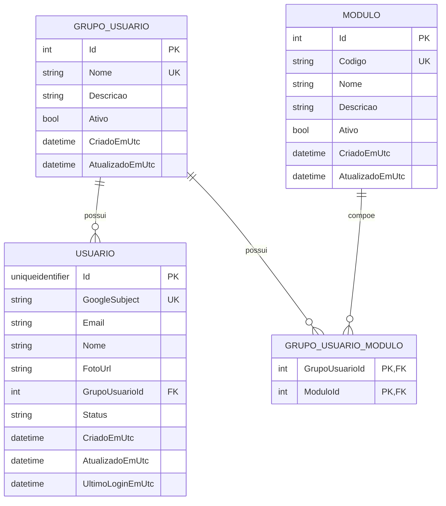

# Autorização e RBAC do LogTrack

O Google responde apenas à pergunta “quem é essa pessoa?”. A API do LogTrack controla a situação cadastral, o grupo e os módulos autorizados.

```text
Google
  ↓ GoogleSubject
Usuario
  ↓ StatusUsuario
GrupoUsuario
  ↓ GrupoUsuarioModulo
Modulo (Codigo)
```

## Modelo



Um `Usuario` pode pertencer a no máximo um grupo. `GrupoUsuarioId` é opcional para permitir aprovação posterior. Os grupos e módulos não são enums.

## Status do usuário

| Status | Comportamento |
|---|---|
| `AguardandoAprovacao` | Identidade Google validada, sem acesso a módulos de negócio; grupo normalmente nulo. |
| `Ativo` | Pode acessar os módulos ativos do seu grupo ativo. |
| `Inativo` | Login recusado com HTTP 403 e sem emissão de novo JWT. |

O login não altera automaticamente `Status`, `GrupoUsuarioId` ou módulos. Ele apenas atualiza e-mail, nome, foto e último login do usuário identificado por `GoogleSubject`.

## Bootstrap do primeiro administrador

Configure o e-mail por User Secrets:

```powershell
dotnet user-secrets set `
  "Bootstrap:AdminEmail" `
  "seu-email-google-de-administrador" `
  --project ".\src\Aplicativo.Api\Aplicativo.Api.csproj"
```

No primeiro login dessa conta, a API cria ou localiza o grupo `Administrador`, associa os módulos iniciais, muda o usuário para `Ativo` e atribui o grupo. O e-mail não fica hardcoded no código.

## Autorização por módulo

A API possui uma policy reutilizável:

```csharp
[Authorize]
[RequireModule("FROTA")]
public IActionResult GetFleet() => Ok();
```

O `ModuleAuthorizationHandler` consulta o banco a cada autorização e exige:

1. usuário autenticado;
2. status `Ativo`;
3. grupo existente e ativo;
4. módulo existente, ativo e associado ao grupo.

As permissões não são gravadas como fonte definitiva no JWT. O JWT contém identidade e informações básicas para a sessão, mas mudanças de grupo ou módulo passam a valer nas próximas autorizações sem depender da expiração do token.

## Endpoints administrativos

Os endpoints abaixo exigem o módulo `ADMINISTRACAO`:

- `GET/POST /api/authorization/groups`
- `PUT /api/authorization/groups/{id}`
- `PUT /api/authorization/groups/{id}/modules`
- `GET/POST /api/authorization/modules`
- `PUT /api/authorization/modules/{id}`
- `GET /api/authorization/users`
- `PUT /api/authorization/users/{id}/access`

Desativação é feita pelo campo `Ativo`; não há exclusão física para não perder histórico e os relacionamentos usam `DeleteBehavior.Restrict`.

## Banco e migration

O modelo fica em `Aplicativo.Core/Models/AuthorizationModels.cs`. O `DbContext` e os mapeamentos Fluent ficam na API. A migration inicial está em `Aplicativo.Api/Migrations` e cria:

- `Usuario`;
- `GrupoUsuario`;
- `Modulo`;
- `GrupoUsuarioModulo`;
- chaves, índices únicos, FKs e chave composta da associação.

Para aplicar a migration:

```powershell
dotnet ef database update `
  --project ".\src\Aplicativo.Api\Aplicativo.Api.csproj" `
  --startup-project ".\src\Aplicativo.Api\Aplicativo.Api.csproj"
```

O endpoint `GET /api/auth/me` consulta o banco e retorna o status atual, o grupo e os módulos ativos para o Mobile montar a navegação. O Mobile pode esconder telas por UX, mas a API continua sendo a autoridade final.
